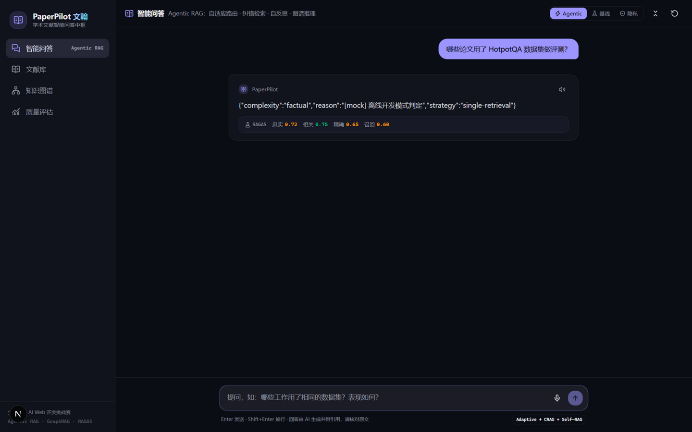
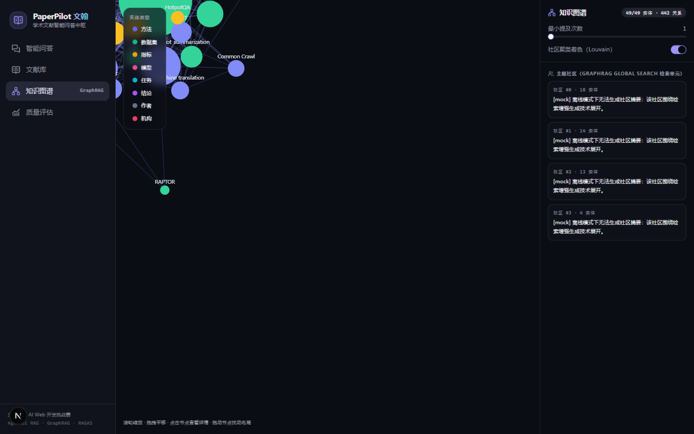
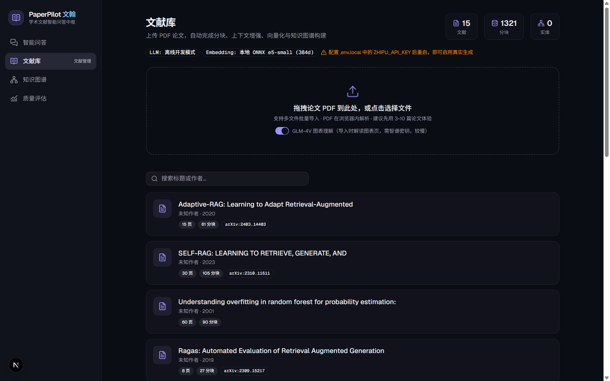
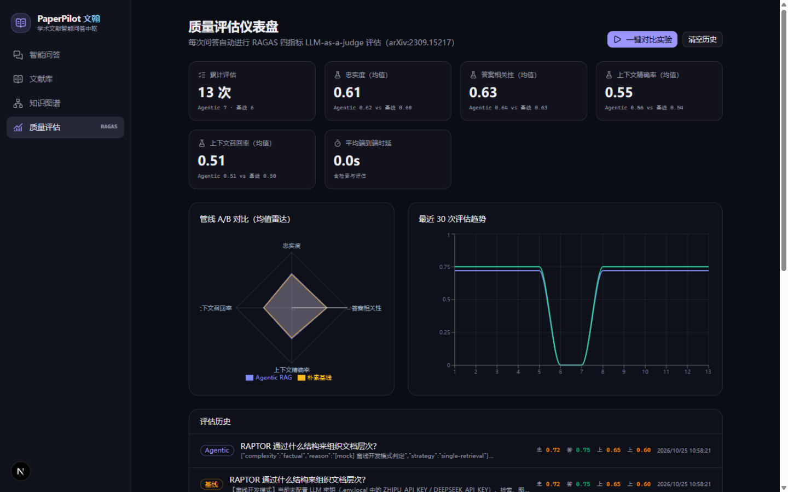

# PaperPilot 文翰

> **基于 Agentic RAG 与 GraphRAG 的学术文献智能问答系统**
> 全国高校 AI Web 开发挑战赛 · RAG 知识问答系统方向

上传论文 PDF，系统自动完成结构化解析、上下文增强分块、向量索引与知识图谱构建。提问时，Agentic RAG 流水线**自主决策**检索策略——按问题复杂度路由、对证据打分纠错、回答前自反思验证——每个论断带 [n] 引用可溯源到页码，每次回答自动进行 RAGAS 四指标量化评估，全程可在「AI 思考时间线」中实时观看。

| 智能问答（时间线 + 引用 + RAGAS） | 知识图谱（社区聚类） |
|---|---|
|  |  |

| 文献库（导入管线） | 质量评估（A/B 雷达对比） |
|---|---|
|  |  |

## ✨ 核心特性

| 能力 | 实现 | 支撑论文 |
|---|---|---|
| **自适应检索路由** | 五档查询复杂度分类 → 直答/单轮/迭代多跳/图谱全局 | Adaptive-RAG (NAACL 2024) |
| **纠错式检索** | 候选文档逐条相关性评分，低置信触发查询改写重检索 | CRAG (2024) |
| **自反思生成** | 关键论断支撑度验证，不足则补检索或降级断言 | Self-RAG (ICLR 2024) |
| **混合检索管道** | 学术化改写 + 3 视角多查询 + HyDE 假设文档 → BM25×向量双路召回 → RRF 融合 → LLM 重排序 → Lost-in-the-Middle 蛇形重排 | HyDE (2022) · RAG-Fusion · Anthropic Contextual Retrieval (2024) · Lost in the Middle (2023) |
| **知识图谱推理** | LLM 实体关系抽取 → 规范化合并 → Louvain 社区发现 → 社区摘要；Local 邻域检索支撑多跳问题，Global 社区检索支撑领域综述 | Microsoft GraphRAG (2024) · LightRAG (2024) |
| **量化质量评估** | 每次回答自动 RAGAS 四指标评分（忠实度/相关性/精确率/召回率），仪表盘 Agentic vs 朴素基线 A/B 对比 | RAGAS (2023) |
| **端侧隐私模式** | Transformers.js 浏览器内嵌入（WebGPU 加速、WASM 降级）+ IndexedDB 向量库；检索全在本地，仅命中片段脱敏上云 | 赛题鼓励的浏览器端 AI 推理 |
| **多模态** | GLM-4V 论文图表理解入向量库；语音提问 + 回答朗读 | — |
| **MCP 工具服务** | 检索器暴露为标准 MCP Streamable HTTP 端点，可被任意 MCP 客户端调用 | MCP 规范 (Anthropic) |
| **AI 安全** | 论断-引用绑定、库外拒答（Sufficient Context 思想）、检索上下文注入过滤器 | Sufficient Context (2024) |

## 🏗 系统架构

```
┌────────────────────────────────────────────────────────────────┐
│ 前端层  Next.js 16 (App Router) · Tailwind v4 · shadcn/ui       │
│   流式对话 · 检索步骤时间线 · 知识图谱力导向图 · RAGAS 仪表盘     │
├────────────────────────────────────────────────────────────────┤
│ 智能体层  Vercel AI SDK · tool calling · maxSteps=10            │
│   classify_query ── Adaptive-RAG 五档路由                       │
│   hybrid_retrieve ─ 混合检索（RRF融合+重排序，返回编号候选）      │
│   grade_documents ─ CRAG 逐条评分（<6分触发纠错重检索）          │
│   graph_search ─── GraphRAG Local邻域 / Global社区摘要           │
│   self_assess ──── Self-RAG 支撑度自评（<7分降级断言）           │
├────────────────────────────────────────────────────────────────┤
│ 检索层                                                         │
│   查询扩展(重写+多视角+HyDE) → BM25(自研,中英混合分词)           │
│   + 向量(云端1024d / 端侧384d) → RRF(k=60) → LLM重排 → 蛇形重排  │
│   GraphRAG：实体6类抽取 → 证据链合并 → Louvain → 社区摘要        │
├────────────────────────────────────────────────────────────────┤
│ 接入层（刻意轻薄，仅 AI 能力接入）                                │
│   智谱 GLM-4.6 (主) · glm-4-flash (轻任务) · embedding-3        │
│   DeepSeek (故障转移) · GLM-4V-flash (图表) · 本地 ONNX e5-small │
│   存储：内存索引 + JSON 快照（零外部数据库依赖）                  │
└────────────────────────────────────────────────────────────────┘
```

## 🚀 快速开始

### 1. 安装与配置

```bash
npm install
npm run fetch:models     # 预下载端侧嵌入模型 (~120MB, 走 hf-mirror, 可跳过)
cp .env.example .env.local   # 填入 ZHIPU_API_KEY（必需）/ DEEPSEEK_API_KEY（可选）
```

> **无密钥也能跑**：系统自动进入离线开发模式（mock 生成 + 本地嵌入），全流水线可联调，界面会给出明确提示。

API 密钥获取：[智谱开放平台](https://open.bigmodel.cn/)（有免费额度，`glm-4-flash` / `glm-4v-flash` 免费）· [DeepSeek](https://platform.deepseek.com/)

### 2. 启动与导入语料

```bash
npm run dev              # http://localhost:3000
npm run fetch:demo       # 下载 15 篇 RAG 领域经典论文（arXiv）
npm run seed:demo        # 一键导入知识库（或直接在文献库页拖拽上传 PDF）
```

演示语料即为本系统所实现技术的**原始论文**（Self-RAG、CRAG、GraphRAG、HyDE、RAPTOR…）——你可以直接问系统"你实现的 Self-RAG 技术在原文中是怎么设计的"。

### 3. 体验路线

1. **智能问答**：试试「哪些论文用了相同的数据集？」（多跳·图谱）、「Self-RAG 和 CRAG 的纠错策略有何不同？」（跨论文对比）、「这个领域的主要技术路线？」（图谱全局）；引用徽标**可点击**查看原文证据片段
2. **质量评估页 →「一键对比实验」**：自动跑 6 道预设题 × [朴素基线 vs Agentic] 双管线并评分，雷达图即刻呈现量化对比
3. **顶部切换 Agentic / 基线 / 隐私** 三档管线，隐私模式下检索全程在浏览器（WebGPU）完成，仅命中片段上云
4. **知识图谱**：Louvain 社区着色、实体邻域高亮、点击查看 1 跳关系与证据
5. **MCP**：`curl -X POST localhost:3000/api/mcp -d '{"jsonrpc":"2.0","id":1,"method":"tools/list"}' -H "Content-Type: application/json"`

## 📁 目录结构

```
src/
├── app/
│   ├── page.tsx              # 智能问答（对话主界面）
│   ├── library/              # 文献库（上传/管理/详情）
│   ├── graph/                # 知识图谱可视化
│   ├── analytics/            # RAGAS 评估仪表盘
│   └── api/
│       ├── chat/             # Agentic RAG 主链路（流式 + 工具编排）
│       ├── ingest/           # 文献导入（SSE 进度）
│       ├── papers/ chunks/   # 文献 CRUD / 分块导出
│       ├── graph/            # 图谱数据
│       ├── evaluate/         # RAGAS 评估
│       ├── vision/           # GLM-4V 图表理解
│       ├── models/           # 端侧模型同源分发
│       └── mcp/              # MCP Streamable HTTP 端点
├── lib/
│   ├── kb/                   # 知识库：分块/图谱抽取/导入编排/存储
│   ├── retrieval/            # BM25 / 混合检索 / 图谱检索
│   ├── local/                # 浏览器端嵌入 + IndexedDB 向量库
│   ├── embeddings.ts         # 云端/端侧嵌入双通道
│   └── llm.ts                # 智谱/DeepSeek/mock 三级模型接入
├── components/               # chat / graph / library UI
└── scripts/                  # fetch-models / fetch-demo / seed-demo
```

## 🛠 技术栈

Next.js 16 · React 19 · TypeScript · Tailwind CSS v4 · shadcn/ui · Vercel AI SDK 4 · Zustand · TanStack Query · pdf.js · d3-force · Transformers.js (ONNX Runtime WebGPU) · graphology + Louvain · recharts

## 📄 文档与交付物

- **[技术文档 PDF（提交版）](docs/PaperPilot-技术文档.pdf)** — 7 页，含封面，已通过质检与视觉验收（源文档 [technical-report.md](docs/technical-report.md)，构建脚本 [pdf-build/](docs/pdf-build/)）
- **[演示视频（WebM，2.5 分钟 1080p）](docs/demo-video.webm)** — 无声录屏成片：问答主秀（Agentic 时间线+引用+RAGAS）→ 知识图谱 → 评估仪表盘 → 文献库；配音请对照 [demo-video-script.md](docs/demo-video-script.md) 口播词

## 🚢 部署

知识库为内存索引 + `.data/` JSON 快照，**在线演示推荐长驻 Node 进程**（Railway / Zeabur / 自有服务器）：

```bash
docker build -t paperpilot . && docker run -p 3000:3000 -v pp-data:/app/.data --env-file .env.local paperpilot
# 或裸机：npm run build && npm start && npm run seed:demo
```

> Vercel 等无状态平台可跑但每次冷启动知识库为空，不建议用于评审演示。

## ⚠️ 声明

回答由大模型生成并附带论文级引用，仅供参考，请以论文原文为准。隐私模式下文献全文与检索过程均在浏览器本地完成，仅命中片段参与云端生成。
